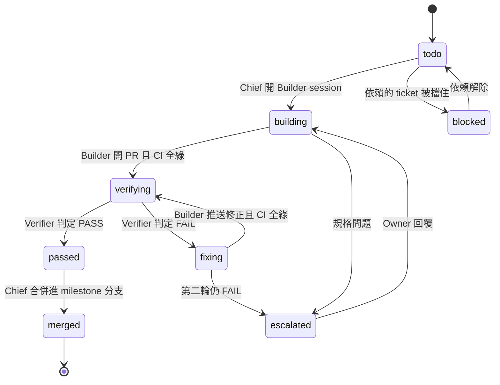

# 開發流程 / Workflow

`AGENTS.md` 是規則的摘要；這個檔案是完整說明。兩者不一致時以這個檔案為準，並在同一個變更中修正 `AGENTS.md`。平行規則在 [`parallel.md`](parallel.md)，角色怎麼跑起來在 [`dispatch.md`](dispatch.md)，CI 檢查在 [`ci-contract.md`](ci-contract.md)。

> **EN:** `AGENTS.md` summarizes; this file is the full description and wins on conflict (fix `AGENTS.md` in the same change). Parallelism: `parallel.md`; how roles run: `dispatch.md`; CI: `ci-contract.md`.

## 1. 分支與合併 / Branches and merging

```text
main                    只有 Owner 合併
└─ milestone/M1         Chief 從 main 開出；ticket PR 的目標分支；Chief 直接推送紀錄
   ├─ ticket/T-101      Builder 的分支，PR 目標是 milestone/M1
   └─ ticket/T-102
```

- 所有 GitHub 操作都以機器帳號 `bot.github` 進行；它只有寫入權限，ruleset 不允許它更新 `main`。
- **Ticket PR 合併進 `milestone/Mx` 的條件全部由機器判定**：CI 全綠、Verifier 的判定為 PASS、沒有動到範圍外的檔案、唯讀路徑沒被修改。四項都成立時 Chief 合併，不需要 Owner。
- **Chief 的紀錄直接推送到 `milestone/Mx`**：看板、ticket 檔、決策、pitfalls、milestone 報告。必要的 CI 檢查只設在 `main`；推送到 `milestone/**` 時 CI 仍會執行，紅燈由 Chief 處理。
- Milestone 的所有 ticket 合併後，Chief 開 `milestone/Mx → main` 的 PR。Owner 審查並合併。
- 更新分支一律用 merge（`git merge origin/milestone/Mx`），不 rebase、不 force-push。

> **EN:** `main` is merged only by the Owner. `milestone/Mx` is cut by the Chief, is the target of ticket PRs, and receives the Chief's records by direct push. The machine account can't update `main`. A ticket PR merges into the milestone when four machine-checkable conditions hold (green CI, Verifier PASS, in scope, read-only paths untouched); the Chief merges it without the Owner. Required CI checks exist only on `main`; CI still runs on pushes to milestone branches. Update branches by merging, never by rebasing or force-pushing.

## 2. 一個 milestone 的流程 / A milestone, step by step

1. Owner 開一個 session，說明要開始哪個 milestone，並指定各角色的模型。這個 session 就是 Chief。
2. Chief 用 `plan-milestone`：讀 `docs/board.md` 與 `docs/milestones/README.md`，依 repo 現況確認或調整該 milestone 的 ticket，開一個標 `plan-approval` 的 issue。
3. **Owner 回覆同意後才開工。**
4. Chief 開 `milestone/Mx` 分支，依依賴關係與平行規則開 Builder session。
5. Builder 用 `build-ticket`，完成後開 PR。
6. Chief 為每個 PR 開一個全新的 Verifier session。Verifier 用 `verify-ticket`，把判定寫成 PR 留言。
7. PASS：Chief 合併、更新看板。FAIL：進入修正輪（第 4 節）。
8. 全部合併後，Chief 用 `milestone-report` 寫報告、開 milestone PR、關閉完成的子 session。

Chief 的 session 中斷時，Owner 開一個新的 session 接手。新的 Chief 從 `docs/board.md` 與 GitHub 上的 PR 狀態重建進度，不需要舊的對話。

> **EN:** The Owner starts the Chief session and names the models; the Chief plans with `plan-milestone` and opens a `plan-approval` issue; nothing starts until the Owner agrees; the Chief cuts `milestone/Mx` and dispatches Builders; each PR gets a fresh Verifier; PASS means merge and update the board, FAIL means a fix round; finally `milestone-report`, the milestone PR, and closing finished child sessions. A replacement Chief rebuilds progress from the board and PR state.

## 3. Ticket 的狀態 / Ticket states



狀態只記在 `docs/board.md`，Chief 是唯一寫入者。

> **EN:** States live only in `docs/board.md`, written only by the Chief.

## 4. 修正輪 / Fix rounds

- 第一輪：原本的 Builder session 依 Verifier 的報告修正。
- 第二輪：開一個新的 Builder session，改用較強的模型（Owner 在計畫核准時指定），從 Verifier 的兩份報告與目前的分支開始。
- 第二輪後仍 FAIL：停止，開 `needs-owner` 的 issue，附上兩份 Verifier 報告與 Chief 對原因的判斷。

Verifier 每一輪都是全新的 session。

> **EN:** Round 1: the original Builder fixes from the Verifier's report. Round 2: a fresh Builder on the stronger model the Owner named, starting from both reports and the current branch. Still FAIL: stop and open a `needs-owner` issue with both reports and the Chief's diagnosis. Every round gets a fresh Verifier.

## 5. 找 Owner 的方式 / Reaching the Owner

唯一的管道是 GitHub issue。Issue 由機器帳號開立，所以 Owner 會收到通知；Owner 需要 watch 這個 repo。

| 標籤 | 用途 | 誰開 |
| --- | --- | --- |
| `plan-approval` | milestone 開始前的計畫核准 | Chief |
| `needs-owner` | 規格問題、未授權的變更、修正兩輪失敗、未涵蓋的敏感領域 | 任何角色，經 Chief |

每個 issue 都要有選項與建議，格式見 `ask-owner`。等待期間，不依賴該 ticket 的其他 ticket 繼續進行；依賴它的標為 `blocked`。

Owner 的回覆由 Chief 記進 `docs/decisions.md`；如果回覆改變了規格，Chief 在同一個 commit 修改規格並更新受影響 ticket 的完成條件。記錄並推送後，**Chief 在 issue 留言寫明 D 編號與 commit，然後關閉 issue**。Owner 只負責回覆，不必關閉。

> **EN:** Issues are the only channel; the machine account opens them so the Owner is notified. Labels: `plan-approval` (Chief, before a milestone) and `needs-owner` (anyone, via the Chief). Every issue has options and a recommendation; unrelated tickets continue, dependants are `blocked`. The Chief records the answer in `docs/decisions.md` (changing the spec and affected tickets in the same commit if needed), comments the decision ID and commit on the issue, and closes it.

## 6. Ticket 契約 / The ticket contract

Ticket 檔（`docs/tickets/T-xxx.md`）是 Chief 與 Builder 之間唯一的契約，也是 CI 的輸入。front matter 使用 `.sop/config.yml` 同一套限制版 YAML：

```yaml
---
id: T-012
title: 一句話
milestone: M2
depends_on: [T-010]
screens: false
allowed_paths:
  - "src/billing/**"
  - "tests/billing/**"
  - "docs/evidence/T-012/**"
append_only: []
serial: [db-schema]
done_when:
  - "tests/billing/test_invoice.py::test_rounding"
status: todo
---
```

| 欄位 | 用途 |
| --- | --- |
| `id` | 與分支 `ticket/T-012` 對應（CI `branch-ticket`） |
| `depends_on` | 排程：依賴的 ticket 都 merged 才能開始 |
| `screens` | 是否需要截圖證據；沒有這個欄位時 CI `evidence` 判為失敗 |
| `allowed_paths` | 可以修改的路徑（CI `path-scope`）；明確列出（不含萬用字元）的唯讀路徑才可以修改 |
| `append_only` | 只增檔案；須同時列在 `allowed_paths`，且在 `append_only_files` 內 |
| `serial` | 序列化資源；須在 `serial_resources` 內 |
| `done_when` | 這些測試 ID 必須在 JUnit 結果中存在且通過（CI `done-when`） |
| `status` | 只由 Chief 修改；實際狀態以 `docs/board.md` 為準 |

本文的固定段落：`## 目標`、`## 要讀的檔案`（只讀這些，保護 Builder 的 context）、`## 完成條件`（與 `done_when` 一一對應的人讀版本）、`## 不在範圍內`。

> **EN:** The ticket file is the only Chief–Builder contract and CI's input, written in the config's restricted YAML. Fields: `id` (matches the branch), `depends_on`, `screens` (required; whether screenshots are needed), `allowed_paths` (read-only paths only when listed exactly), `append_only`, `serial`, `done_when` (test IDs that must exist and pass), `status`. Body sections: goal, files to read (only these), completion conditions, out of scope.

## 7. Context 與記憶 / Context and memory

**短期記憶是 context window，用完即丟。**

- 一張 ticket 一個全新的 Builder session；一個 PR 一個全新的 Verifier session。
- 每個 session 只載入 ticket「要讀的檔案」列出的內容。全部載入會稀釋注意力。
- Chief 不把子 session 的完整輸出讀進自己的 context，只讀 PR 說明、Verifier 判定與 CI 結果。

**長期記憶是 repo。**

- 任何要留到下一個 session 的事實都寫進檔案；`AGENTS.md` 的「記憶」表規定每個檔案誰能寫。
- `docs/pitfalls.md` 只收「下一個 agent 不知道就會再犯」的事，由 Chief 在 milestone 結束時從各 PR 的提議中挑選。上限 30 條；超過時先刪掉已經被 CI 檢查或 skill 取代的條目。刪除的條目不重新編號。
- `docs/decisions.md` 只增不改。改變先前的決定時新增一列，並註明取代哪一列。
- `modules.learning` 開啟時，學習紀錄寫在 `docs/learning.md`，同樣只增不改。

> **EN:** Context windows are disposable: fresh sessions per ticket and per PR, each loading only its ticket's files, and a Chief that reads only PR descriptions, verdicts and CI. The repo is long-term memory: pitfalls are curated by the Chief from PR proposals (max 30, superseded ones removed first, never renumbered); decisions are append-only; with the learning module on, `docs/learning.md` is append-only too.

## 8. 驗證環境 / Verification environment

- 每個 session 在自己的容器裡，有自己的資源（例如資料庫）。沒有共用的測試環境。
- 每個測試從乾淨的狀態開始。
- CI 在每個 PR 上從乾淨的 checkout 執行全部檢查（[`ci-contract.md`](ci-contract.md)）。
- Owner 的獨立驗證：milestone 報告列出實際的操作流程與指令，Owner 用自己選的模型與環境執行。

> **EN:** Each session has its own container and resources; tests start from a clean state; CI runs every check from a clean checkout; the Owner verifies independently by following the report's steps with a model and environment of their choice.

## 9. Milestone 報告與 PR / Reports and PRs

- 每個 milestone 一份 `docs/milestones/Mx.html`，樣板是 `docs/milestones/report-template.html`。內容：為何這樣設計、達成了什麼、Owner 該如何審查與驗證。
- 每個 PR 的說明簡短寫出：完成了什麼、如何驗證、證據、milestone 報告的路徑。樣板是 `.github/PULL_REQUEST_TEMPLATE.md`。
- **證據。** 任何驗證都附證據：CLI 的指令與輸出直接貼上；有畫面的功能附截圖。GitHub 的 API 不能在留言中上傳圖片，所以截圖提交到 `docs/evidence/<ticket 編號>/`，再從 PR 連結。Milestone 報告引用同一批證據。
- **模型。** Builder 的交付留言與 Verifier 的判定留言寫明完成該工作的模型名稱與版本，從 session 的實際設定取得。Chief 在 `docs/board.md` 的備註欄記下每張 ticket 各輪使用的模型。

> **EN:** One HTML report per milestone from `report-template.html`. Short PR descriptions from the PR template. Evidence: CLI output inline, screenshots committed under `docs/evidence/<ticket>/` and linked (the API can't upload images to comments). Models: named in hand-off and verdict comments from the session's configuration; the Chief records each round's model in the board's notes column.

## 10. 這個流程在什麼情況下會失效 / When this process fails

| 情況 | 後果 | 對策 |
| --- | --- | --- |
| 規格本身是錯的 | 全部通過但行為錯誤；自動驗證抓不到 | milestone 報告列出 agent 做過的每個判斷；Owner 審查時對照實際需求 |
| 測試被弱化 | 全綠但沒有驗證到規則 | 規格對 Builder 唯讀（CI 檢查）；`no-weakened-tests` 比對測試結果；Verifier 逐項比對 |
| 測試造假（永遠通過） | 同上 | Verifier 變異抽查：故意改壞產品程式，確認對應的測試會失敗 |
| 平行 ticket 互相衝突 | 合併卡住 | 路徑不重疊；序列化資源一次一張 |
| Chief 的 session 中斷 | 進度停住 | 狀態都在 repo；新的 session 可以接手 |
| 子 session 空轉 | 成本增加 | 修正輪上限兩輪；Chief 在 milestone 結束時關閉所有子 session |

> **EN:** A wrong spec passes everything (mitigated by listing agent judgments for Owner review); weakened or fake tests (read-only specs, result comparison, Verifier mutations); parallel conflicts (disjoint paths, serialized resources); a dead Chief (state in the repo); idle child sessions (two fix rounds max, closing sessions at milestone end).
